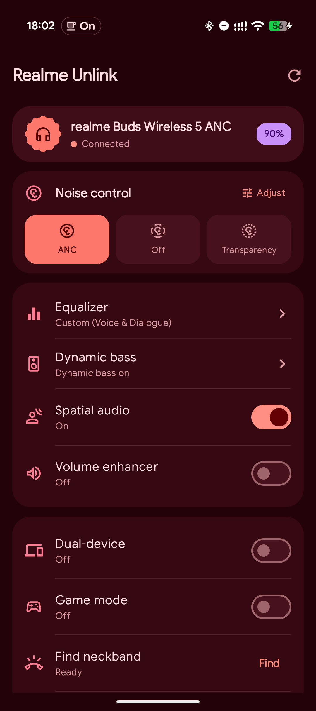

# Realme Unlink

A local, account-free companion for **realme Buds Wireless 5 ANC (RMA2412)** on Pixel 10 / Android 17 (API 37).

<p align="center">
  
</p>

- No cloud dependency, telemetry, account, ads, or `INTERNET` permission.
- Quick Settings tile entrypoint by default; opt-in app drawer icon via the top-bar menu.
- Foreground-only Bluetooth Classic RFCOMM control session.
- Compact Material 3 Expressive UI with dynamic color and bundled Google Sans Flex.

## Features

- One-tap ANC, Transparency, and Off modes.
- ANC levels: Smart, Max, Moderate, and Mild; Smart de-wind control.
- ANC button mode cycling configuration (ANC ↔ Off, ANC ↔ Transparency, Transparency ↔ Off, or all three).
- Hardware EQ profiles (Nature Balance, Bass Boost, Clear Vocals, Clear Bass) and custom six-band EQ with locally curated suggestions.
- Volume enhancer toggle.
- Spatial Audio toggle.
- Dynamic bass enable and Low/Mid/High adjustment.
- Game mode, Auto answer, and dual-device controls when reported by the headset.
- MFB remapping for Single tap, Double tap, Triple tap, and Touch and hold:
  None, Play/Pause, Next track, Previous track, Voice Assistant, and Game mode.
- Foreground Find neckband tone.
- Battery and connection status.

## Connection Model

The app opens its RFCOMM control socket while visible and closes it when backgrounded. It does not run a foreground service or continuously monitor the headset.

### Deliberately Not Implemented

- **Find My Phone from the neckband:** Excluded by design due to power consumption. Listening for asynchronous headset button events while the phone is locked requires maintaining an open RFCOMM link, persistent foreground service, and wake locks, which continuously drains battery on both devices. The locator is phone-to-neckband only during foreground sessions.
- **Background telemetry or control:** Excluded to eliminate standby power drain; would require a persistent background service and ongoing radio polling.
- **Firmware updates:** No trusted local firmware source or validated update path exists.
- **In-app pairing:** Pair through Android Bluetooth settings.
- **Other headset models:** Protocol behavior is validated only for the exact supported model name.

## Build and Test

Set `JAVA_HOME`, `ANDROID_HOME`, and `ANDROID_SDK_ROOT`, then run:

```bash
./gradlew compileDebugKotlin
./gradlew testDebugUnitTest
./gradlew :app:lintDebug
./gradlew :app:assembleDebug
./gradlew :app:assembleRelease
npx --yes markdownlint-cli2
```

Debug APK: `app/build/outputs/apk/debug/app-debug.apk`

## Installation

```bash
adb install -r app/build/outputs/apk/debug/app-debug.apk
```

Add **Realme Unlink** from the Quick Settings editor and tap the tile to open it. Android owns the tile's long-press behavior.

## Debug Diagnostics

Diagnostic activities and probes exist only in debug builds. Release builds use a no-op diagnostics bridge and exclude probe classes.

```bash
# Read current button mappings without writing
adb shell am start -n app.realme.unlink/.MainActivity --ez read_button_mappings true
adb logcat -s UnlinkButtonRead:I

# Guarded recovery to the confirmed baseline
adb shell am start -n app.realme.unlink/.MainActivity --ez restore_button_baseline true
```

Write-capable evidence probes are retained for controlled hardware research only; inspect their guardrails before use.

## Project Documentation

- [AGENTS.md](AGENTS.md) — operational guardrails and documentation rules
- [context/MAP.md](context/MAP.md) — architecture and source map
- [context/DECISIONS.md](context/DECISIONS.md) — durable architectural decisions
- [context/CONVENTIONS.md](context/CONVENTIONS.md) — implementation conventions
- `.pi/todos/` — current task state and concise handoff evidence
