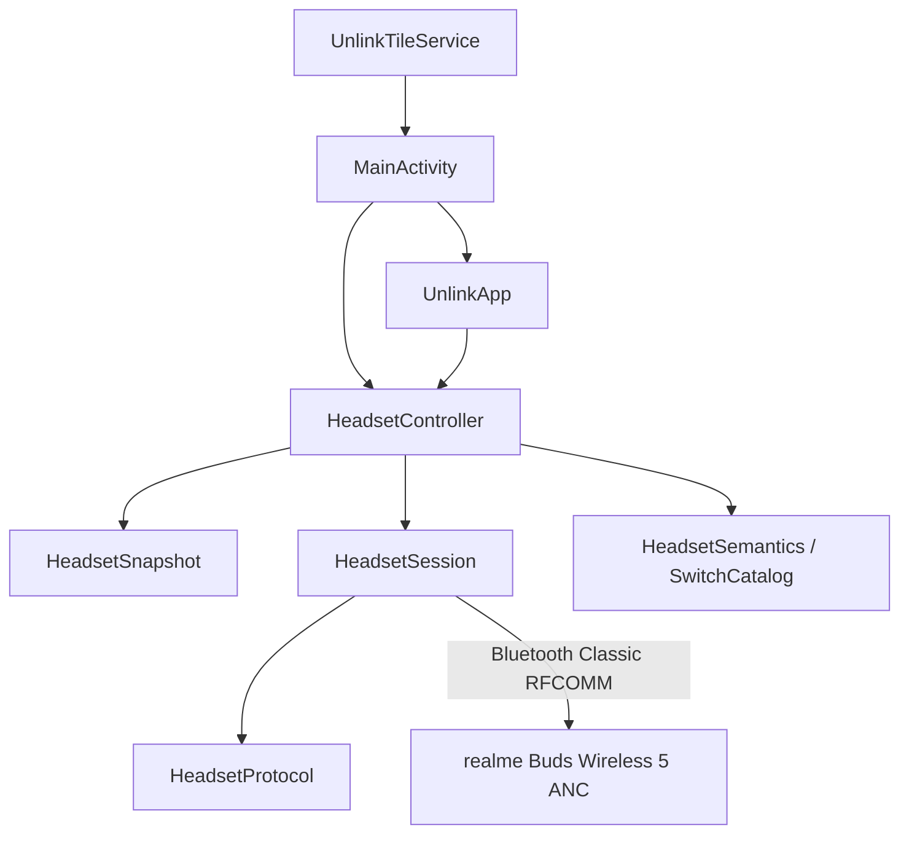

# System Architecture and Code Map

## Runtime Flow

`MainActivity` binds the controller to foreground lifecycle. `HeadsetController` serializes reads and writes on `Dispatchers.IO`, publishes immutable snapshots, applies optimistic updates, and rolls back rejected writes. `HeadsetSession` owns one RFCOMM socket and matches framed responses by command and transfer ID.

## Source Map

### Entrypoints

| Path | Responsibility |
| --- | --- |
| `app/src/main/AndroidManifest.xml:1` | API-37 app, Bluetooth permissions, internal activity, and Quick Settings tile. |
| `app/src/debug/AndroidManifest.xml:1` | Debug-only exported activity for explicit ADB diagnostics. |
| `app/src/main/java/app/realme/unlink/MainActivity.kt:34` | Permission, lifecycle, controller, and Compose host. |
| `app/src/main/java/app/realme/unlink/UnlinkTileService.kt:12` | Quick Settings launch entrypoint. |

### UI

| Path | Responsibility |
| --- | --- |
| `app/src/main/java/app/realme/unlink/ui/UnlinkApp.kt:141` | Root state rendering and modal-sheet coordination. |
| `app/src/main/java/app/realme/unlink/ui/UnlinkApp.kt:336` | Compact device, battery, and connection header. |
| `app/src/main/java/app/realme/unlink/ui/UnlinkApp.kt:608` | Sound group with one-tap noise modes and EQ/Dynamic Audio summaries. |
| `app/src/main/java/app/realme/unlink/ui/UnlinkApp.kt:882` | Device settings group ordered by expected use. |
| `app/src/main/java/app/realme/unlink/ui/UnlinkApp.kt:1138` | ANC level and Smart de-wind sheet. |
| `app/src/main/java/app/realme/unlink/ui/UnlinkApp.kt:1267` | Hardware/custom EQ sheet with curated suggestions. |
| `app/src/main/java/app/realme/unlink/ui/UnlinkApp.kt:1348` | Dynamic Audio sheet. |
| `app/src/main/java/app/realme/unlink/ui/UnlinkApp.kt:1518` | Shared button-assignment sheet and action picker. |
| `app/src/main/java/app/realme/unlink/ui/UnlinkTheme.kt:18` | Dynamic Material 3 Expressive theme and bundled Google Sans Flex typography. |
| `app/src/main/res/font/google_sans_flex.ttf:1` | Local variable font asset. |

### State and Transport

| Path | Responsibility |
| --- | --- |
| `app/src/main/java/app/realme/unlink/HeadsetController.kt:27` | Foreground session lifecycle, serialized operations, validation, optimistic updates, rollback, and graceful locator shutdown. |
| `app/src/main/java/app/realme/unlink/SessionLifecycleGate.kt:1` | Generation ownership preventing stale lifecycle cleanup. |
| `app/src/main/java/app/realme/unlink/HeadsetSnapshot.kt:4` | Immutable device state, capabilities, and per-command read failures. |
| `app/src/main/java/app/realme/unlink/HeadsetSession.kt:28` | RFCOMM transaction serialization, response matching, timeout, and cancellation. |
| `app/src/main/java/app/realme/unlink/HeadsetProtocol.kt:14` | OPPOv1 framing, command encoding, fragmentation, and response parsing. |
| `app/src/main/java/app/realme/unlink/HeadsetCapabilityDiscovery.kt:14` | Canonical read-only query inventory and response models. |

### Semantics

| Path | Responsibility |
| --- | --- |
| `app/src/main/java/app/realme/unlink/DeviceSupport.kt:6` | Exact supported-device identity. |
| `app/src/main/java/app/realme/unlink/HeadsetSemantics.kt:10` | Validated noise, switch, button, and band labels. |
| `app/src/main/java/app/realme/unlink/SwitchCatalog.kt:4` | Validated writable switches and stable UI ordering. |
| `app/src/main/java/app/realme/unlink/EqSuggestions.kt:7` | Local six-band EQ suggestions and value matching. |

### Debug Diagnostics

| Path | Responsibility |
| --- | --- |
| `app/src/debug/java/app/realme/unlink/Diagnostics.kt:1` | Debug ADB dispatcher. |
| `app/src/debug/java/app/realme/unlink/ReadOnlyButtonMappingProbe.kt:1` | GET-only `0x0108` button-mapping reader. |
| `app/src/debug/java/app/realme/unlink/ButtonMappingPersistenceProbe.kt:14` | Guarded mapping recovery and persistence checks. |
| `app/src/debug/java/app/realme/unlink/HeadsetEvidenceProbe.kt:33` | Reversible hardware evidence matrix. |
| `app/src/release/java/app/realme/unlink/Diagnostics.kt:1` | No-op release bridge; probe classes are excluded. |

## Validated Protocol State

- Noise values: Off `1`, Transparency `2`, Mild `4`, Max `8`, Moderate `16`, Smart `32`.
- MFB functions: None `0`, Play/Pause `1`, Voice Assistant `4`, Previous `5`, Next `6`, Game mode `17`.
- Switches: Game mode `6`, Auto answer `8`, dual-device `17`, Smart de-wind `26`, Dynamic Audio `29`.
- Dynamic Audio bands: Low type `1`, Mid type `2`, High type `3`; baseline is `0/0/0`.
- Custom EQ: profile ID `4`, six bands at 50/250/1000/4000/8000/16000 Hz.
- Official EQ IDs confirmed so far: Nature Balance `0`, Clear Vocals `2`, Custom1 `4`.

Volume enhancer and the ANC-button mode-list encoding remain unresolved and are not exposed as writable controls.
