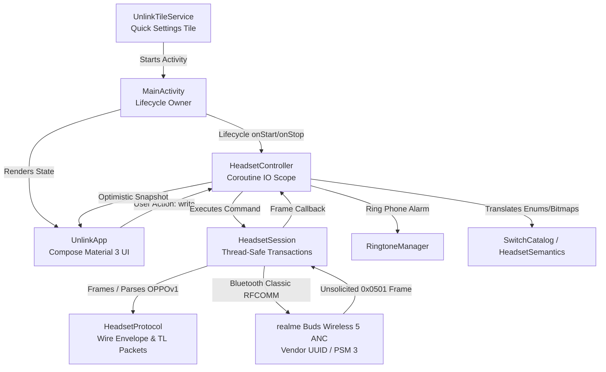
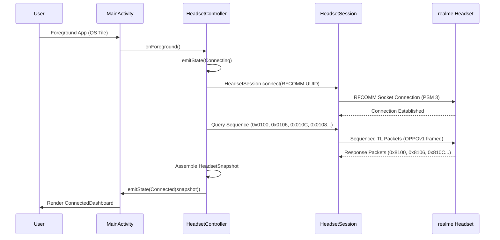
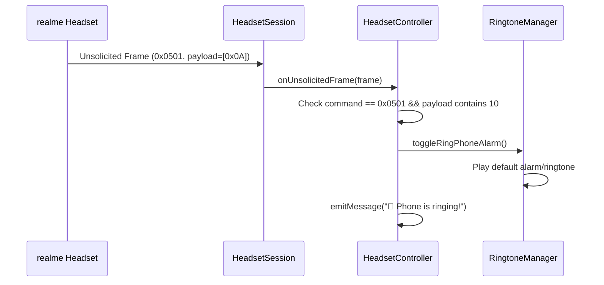

# System Architecture & Code Map (`context/MAP.md`)

## System Architecture



---

## Data Flow Diagrams

### 1. Foreground Connection & Snapshot Refresh Flow



### 2. Optimistic Write & Rollback Flow

```mermaid
sequenceDiagram
    participant User
    participant UI as UnlinkApp UI
    participant HC as HeadsetController
    participant HS as HeadsetSession
    participant HW as realme Headset

    User->>UI: Tap ANC Filter Chip (e.g. Transparency)
    UI->>HC: setNoiseValue(2)
    HC->>HC: Optimistically update snapshot (noise=2)
    HC->>UI: emitState(Connected(optimisticSnapshot))
    UI->>User: Immediate UI update (responsive)
    HC->>HS: setNoiseControl(0x0404, value=2) [Dispatchers.IO]
    HS->>HW: Write packet 0x0404
    alt Hardware Accepts (status = 0x00)
        HW-->>HS: Response 0x8404 (status=0)
        Note over HC: Write confirmed; state retained
    else Hardware Rejects or Socket Timeout
        HW-->>HS: Error or Timeout Exception
        HC->>HC: Rollback snapshot to previous state
        HC->>UI: emitState(Connected(previousSnapshot))
        HC->>UI: emitMessage("Failed noise control", isError=true)
        UI->>User: Visual rollback + snackbar alert
    end
```

### 3. Unsolicited Frame Routing (Ring Phone)



---

## Where Things Live

### Application & Entrypoints

| Path | Primary Responsibility |
| --- | --- |
| `app/src/main/AndroidManifest.xml:1` | App configuration, permissions (`BLUETOOTH_CONNECT`, `POST_NOTIFICATIONS`), and QS tile declaration. |
| `app/src/main/java/app/realme/unlink/MainActivity.kt:34` | Single-activity entry point. Manages permission requests, lifecycle observer for foreground connection, intent handling for probes, and root Compose host. |
| `app/src/main/java/app/realme/unlink/UnlinkTileService.kt:13` | Quick Settings tile entrypoint. Provides click and long-press handling to launch `MainActivity`. |

### UI & Presentation Layer

| Path | Primary Responsibility |
| --- | --- |
| `app/src/main/java/app/realme/unlink/ui/UnlinkApp.kt:98` | Root Compose application surface. Renders connection state banners, hero header, control cards, and bottom sheets. |
| `app/src/main/java/app/realme/unlink/ui/UnlinkApp.kt:180` | `DeviceHeroHeader`: Renders connection status pill, battery badge, and device title without duplicate headers. |
| `app/src/main/java/app/realme/unlink/ui/UnlinkApp.kt:580` | `NoiseCard`: Expressive filter chips for ANC modes (`Strong ANC`, `Mild ANC`, `Smart ANC`, `Transparency`, `Off`) and wind noise toggle. |
| `app/src/main/java/app/realme/unlink/ui/UnlinkApp.kt:630` | `EqCard`: Preset selector chip row + button to open custom 6-band EQ bottom sheet. |
| `app/src/main/java/app/realme/unlink/ui/UnlinkApp.kt:680` | `BassCard`: Multi-band bass level sliders + Dynamic Bass Boost toggle. |
| `app/src/main/java/app/realme/unlink/ui/UnlinkApp.kt:740` | `GameModeCard`: 45ms ultra-low latency toggle card. |
| `app/src/main/java/app/realme/unlink/ui/UnlinkApp.kt:880` | `HardwareButtonsCard`: Neckband Multifunction Remote (MFB) action dropdown remapper. |
| `app/src/main/java/app/realme/unlink/ui/UnlinkApp.kt:960` | `DualDeviceCard`: Displays connected devices and multipoint switch toggle. |
| `app/src/main/java/app/realme/unlink/ui/UnlinkApp.kt:1050` | `SpatialAudioCard`: Displays Android OS spatializer status and provides direct link to system settings. |
| `app/src/main/java/app/realme/unlink/ui/UnlinkApp.kt:1115` | `CustomEqSheet`: 6-band custom EQ slider sheet with preset suggestions (`Pump & Power`, etc.). |
| `app/src/main/java/app/realme/unlink/ui/UnlinkTheme.kt:30` | Material 3 Expressive theme definition using dynamic color and `Google Sans Flex` font family. |

### Controller & Reactive State

| Path | Primary Responsibility |
| --- | --- |
| `app/src/main/java/app/realme/unlink/HeadsetController.kt:29` | Session lifecycle owner. Runs all transactions on `CoroutineScope(Dispatchers.IO)`. Performs optimistic snapshot mutation, rollback, and unsolicited frame dispatch. |
| `app/src/main/java/app/realme/unlink/HeadsetSnapshot.kt:18` | Immutable data model capturing current device state (battery, noise, EQ profiles, custom bands, bass levels, switches, wear, button mappings). |

### Protocol & Wire Transport

| Path | Primary Responsibility |
| --- | --- |
| `app/src/main/java/app/realme/unlink/HeadsetProtocol.kt:14` | Envelope framing, 7-bit varint length encoder/decoder, fragmentation (`wrapFrames`), command encoding, and response decoding. |
| `app/src/main/java/app/realme/unlink/HeadsetSession.kt:28` | Thread-safe RFCOMM socket session. Serializes transactions, matches responses by command and transfer ID, filters unsolicited frames, handles timeouts and cancellation. |

### Domain Semantics & Catalogs

| Path | Primary Responsibility |
| --- | --- |
| `app/src/main/java/app/realme/unlink/HeadsetSemantics.kt:10` | Confirmed value-to-label translation for noise modes, switch features, hardware button actions, and function IDs. |
| `app/src/main/java/app/realme/unlink/SwitchCatalog.kt:7` | Whitelist of proven writable switch feature IDs and logical deduplication/aliasing (e.g. collapsing game mode IDs 6 and 8). |
| `app/src/main/java/app/realme/unlink/EqSuggestions.kt:7` | Pre-calculated 6-band custom EQ preset suggestions for device-reported frequencies. |

### Capabilities & Automation Probes

| Path | Primary Responsibility |
| --- | --- |
| `app/src/main/java/app/realme/unlink/HeadsetCapabilities.kt:11` | Bitfield parser and command-group validation for query command `0x0100`. |
| `app/src/main/java/app/realme/unlink/HeadsetCapabilityDiscovery.kt:14` | Inventory of safe read-only queries and data models for key mappings, bass engine, EQ profiles, and multipoint entries. |
| `app/src/main/java/app/realme/unlink/HeadsetEvidenceProbe.kt:33` | Automated reversible verification matrix exercising all safe read/write command paths with baseline restoration. |
| `app/src/main/java/app/realme/unlink/ButtonMappingPersistenceProbe.kt:14` | Automated persistence and delay-test probe evaluating hardware EEPROM retention of remapped button commands. |
