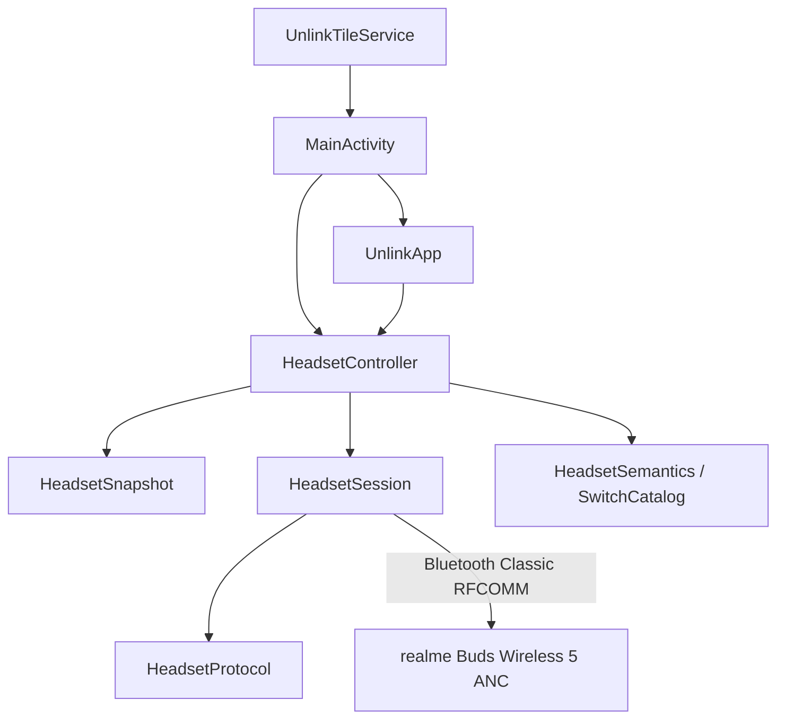

# System Architecture and Code Map

## Runtime Flow

`MainActivity` binds the controller to foreground lifecycle. `HeadsetController` serializes reads and writes on `Dispatchers.IO`, publishes immutable snapshots, applies optimistic updates, and rolls back rejected writes. `HeadsetSession` owns one RFCOMM socket and matches framed responses by command and transfer ID.

## Source Map

### Entrypoints

| Path | Responsibility |
| --- | --- |
| `app/src/main/AndroidManifest.xml:1` | API-37 app, Bluetooth permissions, internal activity, opt-in launcher alias, and Quick Settings tile. |
| `app/src/debug/AndroidManifest.xml:1` | Debug-only exported activity for explicit ADB diagnostics. |
| `app/src/main/java/app/realme/unlink/MainActivity.kt:21` | Permission, lifecycle, controller, launcher-icon toggle, and Compose host. |
| `app/src/main/java/app/realme/unlink/LauncherIconToggle.kt:7` | Opt-in app drawer launcher alias state via `PackageManager`. |
| `app/src/main/java/app/realme/unlink/UnlinkTileService.kt:12` | Quick Settings launch entrypoint. |

### UI

| Path | Responsibility |
| --- | --- |
| `app/src/main/java/app/realme/unlink/ui/UnlinkApp.kt:186` | Root state rendering, pinned top bar, wavy busy indicator, and modal-sheet coordination. |
| `app/src/main/java/app/realme/unlink/ui/UnlinkApp.kt:493` | Compact device, battery pill, and connection header. |
| `app/src/main/java/app/realme/unlink/ui/UnlinkApp.kt:795` | Noise control card with connected button group and Adjust action. |
| `app/src/main/java/app/realme/unlink/ui/UnlinkApp.kt:946` | Sound segmented list group (Equalizer, Dynamic bass, Spatial audio, Volume enhancer). |
| `app/src/main/java/app/realme/unlink/ui/UnlinkApp.kt:1110` | Device settings segmented list group ordered by expected use. |
| `app/src/main/java/app/realme/unlink/ui/UnlinkApp.kt:1366` | ANC level, Smart de-wind, and connected button-cycling sheet. |
| `app/src/main/java/app/realme/unlink/ui/UnlinkApp.kt:1618` | Hardware/custom EQ sheet with curated suggestions and stateful sliders. |
| `app/src/main/java/app/realme/unlink/ui/UnlinkApp.kt:1842` | Dynamic bass sheet with stateful band sliders. |
| `app/src/main/java/app/realme/unlink/ui/UnlinkApp.kt:1982` | Shared button-assignment sheet and animated action picker. |
| `app/src/main/java/app/realme/unlink/ui/UnlinkTheme.kt:40` | Dynamic Material 3 Expressive theme and bundled variable Google Sans Flex typography. |
| `app/src/main/res/font/google_sans_flex.ttf:1` | Local variable font asset (`GoogleSansFlex[ROND,opsz,slnt,wdth,wght].ttf`). |

### State and Transport

| Path | Responsibility |
| --- | --- |
| `app/src/main/java/app/realme/unlink/HeadsetController.kt:27` | Foreground session lifecycle, serialized operations, validation, optimistic updates, rollback, and graceful locator shutdown. |
| `app/src/main/java/app/realme/unlink/HeadsetSession.kt:35` | Low-level RFCOMM transport, packet assembly, checksum framing, and frame filtering. |
| `app/src/main/java/app/realme/unlink/HeadsetProtocol.kt:11` | Wire opcodes, frame encode/decode, and payload builders. |
| `app/src/main/java/app/realme/unlink/HeadsetCapabilities.kt:10` | Bitmap-based command capabilities parser. |
| `app/src/main/java/app/realme/unlink/HeadsetCapabilityDiscovery.kt:13` | Safe read-only discovery queries and response parsers. |
| `app/src/main/java/app/realme/unlink/HeadsetSnapshot.kt:4` | Immutable product-facing state snapshot. |
| `app/src/main/java/app/realme/unlink/SessionLifecycleGate.kt:1` | Generation-bound session ownership guarding concurrent lifecycle tasks. |

### Hardware Mapping and Semantics

| Path | Responsibility |
| --- | --- |
| `app/src/main/java/app/realme/unlink/DeviceSupport.kt:6` | Exact supported-device identity. |
| `app/src/main/java/app/realme/unlink/HeadsetSemantics.kt:10` | Validated noise, switch, button, and band labels. |
| `app/src/main/java/app/realme/unlink/SwitchCatalog.kt:4` | Validated writable switches and stable UI ordering. |
| `app/src/main/java/app/realme/unlink/EqSuggestions.kt:7` | Local six-band EQ suggestions and value matching. |

### Debug Diagnostics

| Path | Responsibility |
| --- | --- |
| `app/src/debug/java/app/realme/unlink/Diagnostics.kt:1` | Debug ADB dispatcher. |
| `app/src/debug/java/app/realme/unlink/ReadOnlyButtonMappingProbe.kt:1` | GET-only `0x0108` button-mapping reader. |
| `app/src/debug/java/app/realme/unlink/ButtonMappingPersistenceProbe.kt:14` | Guarded mapping recovery and persistence checks. |
| `app/src/debug/java/app/realme/unlink/HeadsetEvidenceProbe.kt:33` | Reversible hardware evidence matrix. |
| `app/src/release/java/app/realme/unlink/Diagnostics.kt:1` | No-op release bridge; probe classes are excluded. |

## Validated Protocol State

- Noise values: Off `1`, Transparency `2`, Mild `4`, Max `8`, Moderate `16`, Smart `32`.
- ANC cycle modes: ANC and Off `3`, ANC and Transparency `9`, Transparency and Off `10`, All modes `11` via `0x010C`/`0x0404` (action `2`).
- MFB functions: None `0`, Play/Pause `1`, Voice Assistant `4`, Previous `5`, Next `6`, Game mode `17`.
- Switches: Game mode `6`, Auto answer `8`, dual-device `17`, Smart de-wind `26`, Spatial Audio `27`, Dynamic bass `29`.
- Dynamic bass bands: Low type `1`, Mid type `2`, High type `3`; baseline is `0/0/0`.
- Custom EQ: profile ID `4`, six bands at 50/250/1000/4000/8000/16000 Hz.
- Official EQ IDs: Nature Balance `0`, Bass Boost `1`, Clear Vocals `2`, Clear Bass `3`, Custom `4`.
- Volume Enhancer: GET `0x0110` (response `0x8110`), SET `0x0407` with 1-byte payload (`1` for enabled, `0` for disabled).

## Intentional Feature Exclusions

- **Find Phone from Headset:** Excluded by design. Listening for button events from the headset while the phone is locked requires an open RFCOMM socket, persistent foreground service, and partial wake locks, draining battery on both devices.
- **Earbud Fit Test (`ITEM_COMPACTNESS_DETECT`):** Excluded because neckband hardware lacks optical in-ear proximity sensors.
- **Golden Hearing / HearID (`ITEM_HEAR_ID`):** Excluded by the strict zero-telemetry and local-only architecture (the vendor feature relies on proprietary cloud hearing-curve calibration).
